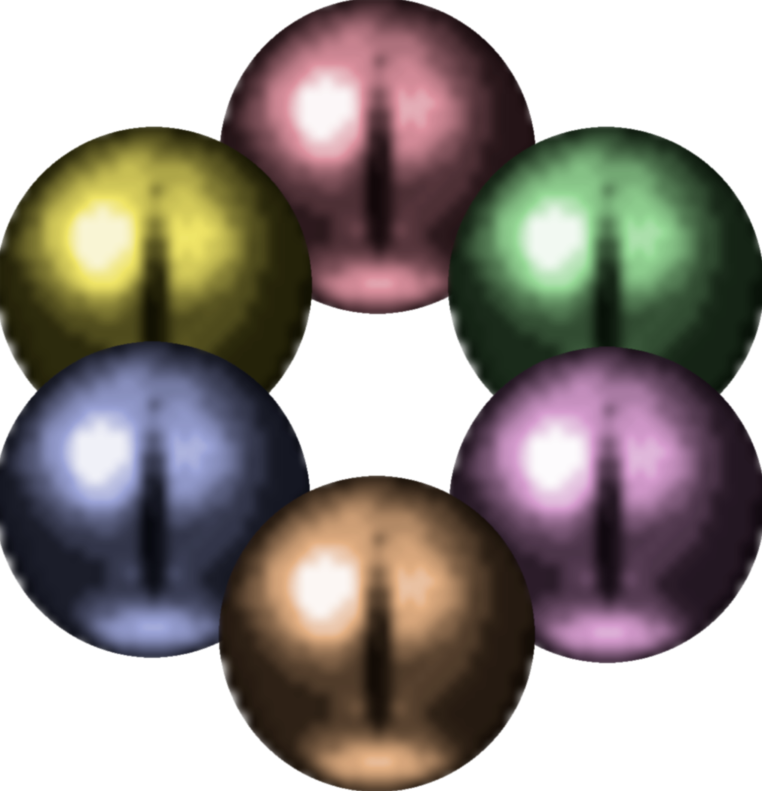

# Archipelagoon

This mod allows Severed Chains to connect to the archipelago.gg multiworld randomizer.

### THIS DOES NOT WORK STANDALONE

# Links

[APWorld ](https://github.com/pkolb-dev/Archipelago/releases/latest) | [Archipelagoon](https://github.com/pkolb-dev/Archipelagoon/releases/latest) | [Setup Guide](https://github.com/pkolb-dev/Archipelago/blob/main/worlds/legend_of_dragoon/docs/en_setup.md )

# AI Disclosure

The Legend of Dragoon APWorld and Archipelagoon mod do not use LLM/AI for development at this time.

# What is randomized in this game?

### Implemented:

- Additions
- Magic
- Goods
- Dragoon Spirits
- Equipment
- Items
- Characters
- Non-Gold Chests

### Planned:

- Gold Chests
- Commands (attack/defend/etc)
- Addition combos
- & more

# What Legend of Dragoon items can appear in other players' worlds?

Additions, Magic, Items, Equipment, Goods, Dragoon Spirits.

# What do other players' items look like in Legend of Dragoon?

Shops will display an Archipelago Logo (colored/blue/white) denoting item type (progression/useful/filler).
Chests will show a message for what gets sent